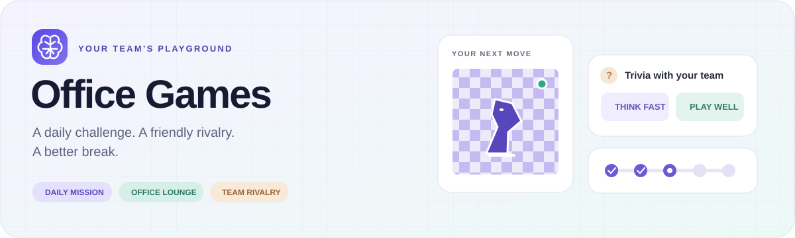

<p align="center">
  
</p>

<p align="center">
  <a href="https://github.com/Themaistro/Office-games-SAAS-/actions/workflows/verify.yml"></a>
  
  
  
  
</p>

<p align="center">
  <a href="#the-experience">The experience</a> ·
  <a href="#run-locally">Run locally</a> ·
  <a href="docs/architecture.md">Architecture</a> ·
  <a href="docs/index.md">Documentation</a> ·
  <a href="CONTRIBUTING.md">Contributing</a>
</p>

# Office Games

A team playground for the workday. Take on a rotating Daily Mission, challenge a coworker, join a group game, or watch an office rivalry unfold.

**Status:** active development and local validation. This repository is the development baseline; a successful build is not a production-readiness certification. Each company installation currently has its own database. Cross-company competition is a future direction.

## The experience

| Play your way              | What is available                                                                                                                                                                                          |
| -------------------------- | ---------------------------------------------------------------------------------------------------------------------------------------------------------------------------------------------------------- |
| **Daily Mission**          | Rotating memory, logic, maths, word, reaction and knowledge challenges. Configurable game counts and difficulty rounds, history-aware content selection, company trivia, saved progress, hints and timing. |
| **Office Lounge**          | Chess, Connect Four and Tic-Tac-Toe, plus Trivia and Mixed Challenges in duel/group rooms. Direct invitations, live matches and spectators.                                                                |
| **Friendly competition**   | Mission XP, levels, streaks and leaderboards; a separate shared Lounge rank and LP progression.                                                                                                            |
| **Stay connected**         | Online contacts, direct-message popups, unread indicators and challenge notifications across the player experience.                                                                                        |
| **Company administration** | Player roster, departments, announcements, onboarding, content, mission settings and season operations.                                                                                                    |

Board-game invitations and rematches share lifecycle rules: duplicate prevention, cancellation, expiry, busy-player warnings, acceptance tracking and idempotent results. Group rooms use the party service; group “Play again” remains a follow-up rather than a completed board-rematch feature.

## Built to grow

Office Games is a **modular monolith**: features own their rules, workflows and persistence, while common game behavior stays in shared services.

```text
Presentation                 Pages, components, server actions and API routes
       ↓
Feature entry points         composition.ts / public-server.ts
       ↓
Application + domain         Workflows, contracts, scoring and game rules
       ↑
Infrastructure               PostgreSQL and external-service adapters
```

Domain code stays independent of React, Next.js and PostgreSQL. Automated checks protect import boundaries, detect dependency cycles and prevent server code from entering browser bundles. Multiplayer state is authoritative on the server; realtime events provide fast updates and polling supports recovery.

```text
src/app/                 Routes and page composition
src/features/            Feature-owned domain, application and infrastructure
src/components/          Shared UI and game presentation
src/hooks/               Reusable interaction and synchronization hooks
src/server/              Database, HTTP and realtime infrastructure
db/                      Bootstrap, versioned migrations and content release
scripts/                 Provisioning and verification tools
docs/                    Architecture, development guides and audit evidence
```

Read the [architecture guide](docs/architecture.md) and [new-game integration guide](docs/adding-a-game.md) before adding another game.

## Run locally

Use Node.js **24** and PostgreSQL **16**. Docker is optional; it is one way to run the local database.

```bash
git clone https://github.com/Themaistro/Office-games-SAAS-.git
cd Office-games-SAAS-
npm ci
```

Copy [.env.example](.env.example) to `.env.local` and configure the connection for your local database:

```powershell
# PowerShell
Copy-Item .env.example .env.local
```

```bash
# macOS / Linux
cp .env.example .env.local
```

Choose the database path that matches your setup:

| Database                                | Initialization                                                                                                                                     |
| --------------------------------------- | -------------------------------------------------------------------------------------------------------------------------------------------------- |
| **Docker Compose**                      | Run `docker compose up -d postgres`. Compose initializes the schema on a fresh volume; then run the migration and content commands below.          |
| **Your own empty PostgreSQL database**  | Create the database, update `DATABASE_URL`, then run `npm run db:bootstrap -- --local` once. Follow with the migration and content commands below. |
| **Existing local application database** | Skip bootstrap. Apply migrations and install missing master-bank content below.                                                                    |

```bash
npm run db:migrate -- --local
npm run db:seed-content -- --local
npm run dev
```

Open [localhost:3000](http://localhost:3000). Register your own local account; test accounts and passwords are not distributed with the repository. The [development guide](docs/development.md) explains environment variables, administration and common setup problems.

### Realtime configuration

Set `ABLY_API_KEY` on the **server** to enable realtime delivery. Browsers obtain scoped tokens through `/api/realtime`; never expose a publisher key through a `NEXT_PUBLIC_*` variable. Shared channels include the company identity: `company:{companyId}:game:{gameType}:{gameId}`. See the [deployment runbook](docs/deployment-runbook.md) for provisioning and credentials.

## Verify changes

```bash
# Formatting, lint, types, architecture and domain/gameplay regressions
npm run verify

# Also exercise the local database and create an optimized build
npm run verify -- --database --build

# HTTP regression checks against a temporary local production server
npm run test:http
```

Database tests use temporary fixtures and require the local configuration. The HTTP command requires a completed build and free port `3100`. Generated reports go to the ignored `output/` directory. GitHub Actions runs the platform checks with an isolated PostgreSQL service; the badge above reflects the actual workflow status.

Checks cover game rules, generated content, mission configuration, company identity, match settlement, rematches, party workflows and snapshot recovery. Local tests are not a substitute for real multiplayer browser sessions or hosted capacity testing.

## Explore the project

- [Documentation hub](docs/index.md) — current guides and dated audit evidence.
- [Architecture](docs/architecture.md) — feature ownership, dependencies and company isolation.
- [Add a game](docs/adding-a-game.md) — required contracts and shared services.
- [Deployment and database runbook](docs/deployment-runbook.md) — migration, identity and rollout procedures.
- [Content review status](docs/content-review-status.md) — content quality work and remaining review.
- [Contributing](CONTRIBUTING.md) · [Security reporting](SECURITY.md).
- [Roadmap](ROADMAP.md) — current validation priorities and longer-term direction.

No open-source license has been selected for this repository.
